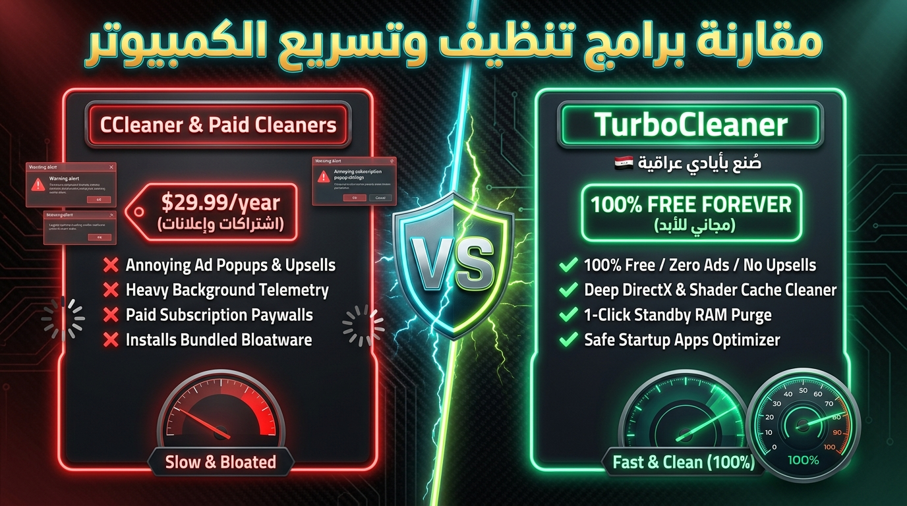

# 🧹 TurboCleaner — Deep PC & RAM Optimizer

> Ultra-fast, modern, 100% ad-free Windows junk cleaner and memory optimizer. Designed as a clean-room, bloatware-free alternative to CCleaner.

---

## 🚀 Key Features

* **🧹 Deep Junk Cleaner**:
  * **Windows & User Temp**: Cleans lingering temporary files created by applications.
  * **DirectX & GPU Shader Cache**: Safely deletes stale GPU shader caches (NVIDIA, AMD, Intel, DirectX).
  * **Windows Update Leftovers**: Reclaims gigabytes of stale downloaded update packages (`SoftwareDistribution\Download`).
  * **Browser Caches**: Safely cleans Chrome and Edge caches without deleting your saved passwords or bookmarks.
  * **Crash Dumps & Error Logs**: Deletes massive memory dump files (.dmp) and error telemetry.
* **⚡ Standby RAM Purge**:
  * Flushes idle standby memory and trims process working sets with 1 click to eliminate micro-stutters before launching heavy games or software.
* **🚀 Startup Apps Manager**:
  * Identifies apps that silently launch with Windows and shows their boot impact (High / Medium / Low).
  * 1-Click disable to make your PC boot in seconds.
* **🛡️ 100% Safe & Ad-Free**:
  * Zero telemetry, zero bloatware, zero third-party software bundles.
* **🌐 Bilingual Support**:
  * Instant toggle between **English 🌐** and **Arabic 🇮🇶**.

---

## 📥 Installation

1. Download the latest installer: [**TurboCleaner Setup 1.0.0.exe**](https://github.com/mohammedtawad88-hue/TurboCleaner/releases/download/v1.0.0/TurboCleaner.Setup.1.0.0.exe).
2. Run the installer wizard.
3. Launch TurboCleaner and click **SCAN PC JUNK**!

---

## 📄 License
MIT License. Free for personal and commercial use.
